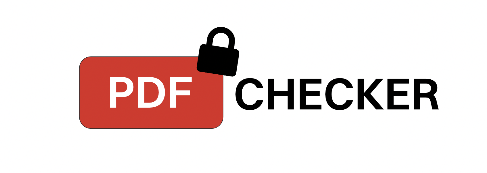

<p align="center">
  
</p>

<h1 align="center">PDF Security Checker</h1>

PDF Security Checker is a command-line tool that inspects PDF files for security threats and extracts forensic information. It combines cryptographic hashing, embedded-script analysis, structural inspection, and threat-intelligence enrichment into a single risk score, and can produce tamper-evident PDF reports.

A sample of the generated report is available [here](docs/report_sample.pdf).

## Features

- **Link extraction** — Finds URLs in annotations, visible text, actions, and recovered JavaScript, optionally defangs them, and checks them against VirusTotal and/or URLhaus (abuse.ch).
- **Metadata analysis** — Extracts document properties, PDF/A and PDF/X compliance, and file-system attributes (size, timestamps, permissions).
- **JavaScript detection** — Extracts document-, page-, and form-level JavaScript and flags patterns that suggest malicious intent, distinguishing auto-run scripts from inert ones.
- **Embedded file detection** — Enumerates attachments and hidden `/EmbeddedFile` streams, classifies them by extension, magic bytes, and content mismatches, hashes each payload, and can safely extract them.
- **Structural anomaly detection** — Flags dangerous constructs such as `/Launch`, `/OpenAction`, `/AA`, XFA forms, RichMedia, remote GoTo, and name-obfuscated keywords, reports incremental updates and repaired cross-reference tables, and detects polyglot files with data hidden before `%PDF` or after `%%EOF`.
- **QR code detection** — Renders pages and decodes QR codes so URLs hidden in images can be reviewed and checked like ordinary links (optional dependency).
- **Risk scoring** — Combines all modules into a weighted 0–100 score with a per-category breakdown and a Minimal-to-Critical rating; decisive indicators raise a severity floor so they cannot be averaged away.
- **Hashing** — Computes MD5, SHA-1, and SHA-256 hashes, with optional VirusTotal and URLhaus lookups of the SHA-256 hash.
- **Report generation** — Produces a PDF report covering every module, including the original file's hash and the report's own hash.
- **Bulk processing** — Analyzes whole folders in parallel and ranks files by risk.
- **Machine-readable output** — Emits structured JSON for scripts, CI pipelines, and mail-gateway automation.
- **Indicator export** — Exports deduplicated URLs, domains, and JavaScript with source provenance as JSON or a STIX 2.1 bundle.

## Installation

PDF Security Checker requires Python 3.8 or higher.

```bash
# Clone the repository
git clone https://github.com/mstradaa/pdfchecker.git
cd pdfchecker

# Install (provides the `pdfchecker` command)
pip install -e .

# Optional extras
pip install -e '.[qr]'     # QR code detection
pip install -e '.[yara]'   # local YARA rules
```

## Quick Start

Start with a full terminal scan. These commands are non-interactive, perform no
external lookups, and leave the input PDFs unchanged:

```bash
pdfchecker -a invoice.pdf
pdfchecker -a samples/ --campaigns
pdfchecker -a samples/ --recursive --campaigns --json
pdfchecker -a invoice.pdf --fail-on-risk 55
```

The full scan shows risk, finding counts, link-text mismatches, YARA matches when
requested, and coverage for each check. Coverage is independent of risk:

| Status | Meaning |
| --- | --- |
| completed | The check finished within its supported scope; findings may still exist |
| failed | A parser or analyzer error prevented reliable completion |
| unavailable | An optional component, such as QR decoding, is not installed |
| limited | A page, character, byte, time, or decoding limit left content uninspected |
| not requested | An opt-in check, such as YARA, was not requested |

A low score is a local heuristic result, not proof that a file is safe.

## Documentation

The [usage reference](docs/usage.md) covers every command-line option and how to:

- [Scan folders and group related samples](docs/usage.md#bulk-scans-and-related-samples)
- [Scan password-protected PDFs](docs/usage.md#password-protected-pdfs)
- [Understand URL discovery](docs/usage.md#url-discovery) and link mismatches
- [Match local YARA rules](docs/usage.md#local-yara-rules)
- [Produce JSON output](docs/usage.md#json-output) for scripts and CI pipelines
- [Export indicators](docs/usage.md#indicator-export) as JSON or STIX 2.1
- [Configure VirusTotal and URLhaus keys](docs/usage.md#threat-intelligence-keys)
- [Review the processing limits](docs/usage.md#limits)

## Policies

Use `--fail-on-risk N` for a simple inclusive threshold, or `--policy FILE` for a
reusable JSON policy:

```json
{
  "risk_threshold": 55,
  "reject_javascript": true,
  "reject_attachments": true,
  "reject_link_mismatch": true,
  "reject_yara": true,
  "require_complete": true
}
```

All keys are optional; omitted boolean rules are disabled. `--fail-on-risk`
overrides the policy's threshold. `reject_yara` requires
[`--yara RULES`](docs/usage.md#local-yara-rules), and `require_complete` blocks
files whose coverage is incomplete. An unevaluable
required check is reported as unknown, never as a policy pass.

```bash
pdfchecker -a samples/ --policy policy.json --yara rules.yar
```

## Performance

Measured on a 10-core Apple Silicon Mac with a 20-page PDF (text, one image per page, links, JavaScript, an attachment):

| Task | Time |
| --- | --- |
| Full scan, all checks including QR decoding | ~0.4 s |
| Full scan without the optional `qr` extra | ~0.08 s |
| `pdfchecker -a file.pdf`, including Python start-up | ~0.7 s |
| `pdfchecker -a` on a folder of 40 such PDFs | ~8 s (~17 s one at a time) |
| Rendering the PDF report | ~0.05 s |

QR decoding accounts for about 80% of a full scan.

## Security Considerations

- **Input validation** — File type, path, and size are validated, JavaScript and metadata extraction are length-capped, and a memory guard aborts on decompression bombs.
- **Secure API handling** — VirusTotal and URLhaus traffic is HTTPS-only with strict timeouts.
- **Key storage** — Keys are stored in the OS-native keychain (Keychain, Credential Manager, GNOME Keyring, KWallet); insecure plaintext backends are rejected.
- **Forensic integrity** — Reports include the original file's hash, the report's own hash, UTC timestamps, and the tool version to support reproducible analysis.

## License

Released under the [MIT License](LICENSE).
